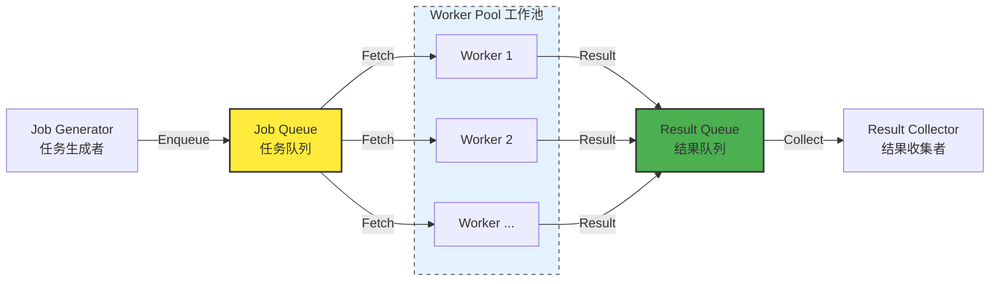
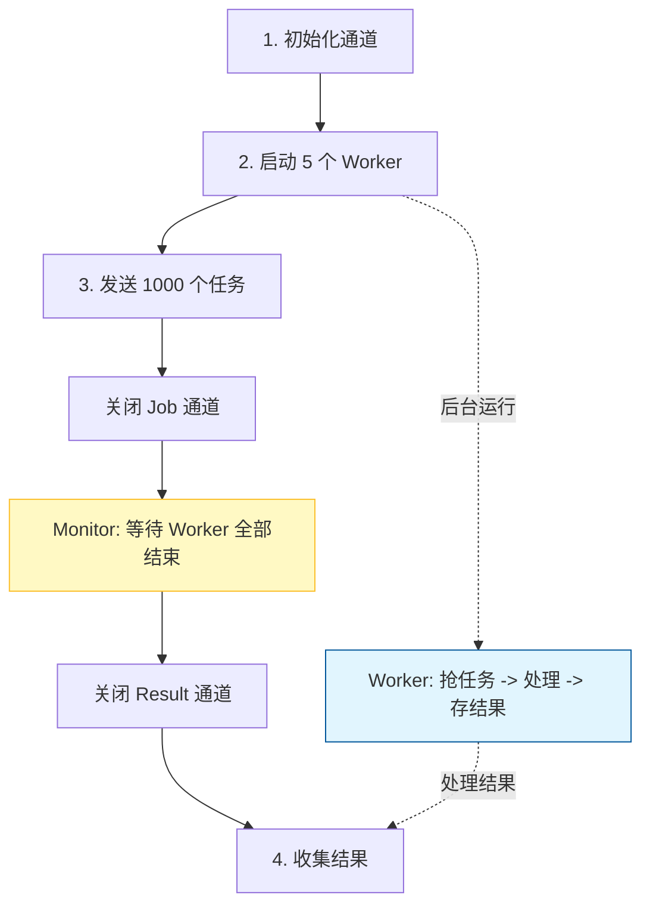

# 背景

最近有个业务需求，需要去[小红书开放平台](https://ad-market.xiaohongshu.com/docs-center?bizType=943&articleId=2734)对接一些报表数据接口，通过定时任务，在每天特定的时间点拉取效果数据并落库。<!-- more -->

对接第三方接口需要遵守他们的规则。小红书接口单页允许的 `page_size` 最大为 100，这就意味着，如果有 100 万条数据，那么就需要做 1 万次 “拉取-落库” 的动作。单线程去做的话会非常耗时，因此需要利用 Go 并发编程的特性去多线程并发。


让 Claude 4.5 Opus 实现功能之后，发现它使用了一种叫 `Worker Pool` (工作池) 的并发模式，通过 Gemini 进行学习了解后，发现这是 Go 中一种非常经典且高效的并发设计模式，正好最近刚学习完 `Goroutine`、`Channel`、`sync.WaitGroup` 等概念，`Worker Pool` 是一个综合的实践，而且 `Worker Pool` 的示例代码虽然看上去一眼就懂，但其实有很多细节我发现自己并没有完全理解（记录在了最后的 FAQ 章节），因此打算做一个记录~

# `Worker Pool` 的核心思想

> Gemini 的一句话总结和举例，我觉得非常完美，做到了 “多则惑，少则缺”，因此直接照抄过来。 

`Worker Pool` 的核心思想是：提前创建固定数量的 `Goroutine`（工作协程），让它们竞争式地从一个任务队列中获取并处理任务。

就像是一个工厂的流水线，无论有多少订单（任务），流水线上只有固定数量的工人（Worker）在干活。

# 为什么需要 `Worker Pool`？

虽然 `Goroutine` 非常轻量（仅需 2KB 内存，作为对比，操作系统线程需要 2MB），但在处理海量任务时，如果直接为每个任务创建一个新的 `Goroutine`（还是前文的例子，假设有 100 万条数据，但每次最多只能拉取 100 条，如果为每个拉取 100 条数据的任务创建一个 `Goroutine`，那么就需要同时创建 1 万个），会产生以下问题：

- 资源耗尽： 瞬时创建上万个 `Goroutine` 可能导致内存溢出。
- 上下文切换开销： 过多 `Goroutine` 会增加 CPU 调度器的负担。
- 缺乏控制： 难以限制对下游资源（如数据库连接、API 调用）的并发访问。

`Worker Pool` 通过 **“复用”** 和 **“限额”** 解决了这些问题。

# 核心结构

一个典型的 `Worker Pool` 由三个部分组成：

- `Job Queue` (任务队列)： 通常是一个 `channel`，用于存放待处理的任务。
- `Worker` (工人)： 一组在后台循环运行的 `Goroutine`。
- `Result Queue` (结果队列)： 可选，用于收集处理后的结果。



# Talk is cheap, show me the code!

一个简单的流程示意图，对应后续代码中的执行步骤：



```go
package main

import (
    "fmt"
    "sync"
    "time"
)


/**
 * worker 函数：对应「核心结构」章节中的 Worker，从 jobs 通道读任务，处理后发给 results 通道
 * @param id      工人编号
 * @param jobs    只读通道 (<-chan)：工人只能从这里拿任务
 * @param results 只写通道 (chan<-)：工人只能把结果往这里放
 * @param wg      计数器：用来告诉主程序自己什么时候干完活
 */
func worker(id int, jobs <-chan int, results chan<- int, wg *sync.WaitGroup) {
    // defer 保证即使函数中途出错，也会在退出前执行 Done()，避免主线程死锁
    defer wg.Done()

    // range 会不断从 jobs 中取数据，直到 jobs 通道被 close(jobs) 且数据取完
    for j := range jobs {
        fmt.Printf("Worker %d 开始处理任务 %d\n", id, j)

        // 模拟耗时的真实业务逻辑（如调用小红书 API、读写数据库）
        time.Sleep(time.Second)

        // 处理完后将结果放入结果通道
        results <- j * 2
        fmt.Printf("工人 %d: 完成任务 %d\n", id, j)
    }
}

func main() {
    const numJobs = 1000 // 假设一共有 1000 个任务
    const numWorkers = 5 // 限制并发数为 5（控制压力），最多只有 5 个 worker 同时处理，可以灵活配置

    // 初始化【任务通道】和【结果通道】
    jobs := make(chan int, numJobs) // 对应「核心结构」章节中的 Job Queue (任务队列)：通常是一个 channel，用于存放待处理的任务
    results := make(chan int, numJobs) // 对应「核心结构」章节中的 Result Queue (结果队列)：可选，用于收集处理后的结果

    var wg sync.WaitGroup

    // 1. 启动指定数量的 worker，目前数量是 5 
    // 此时工人已经就绪，但在 jobs 通道没数据前，他们都会阻塞在 range 那行 “待命”
    for w := 1; w <= numWorkers; w++ {
        wg.Add(1)
        go worker(w, jobs, results, &wg)
    }

    // 2. 发送任务到队列
    for j := 1; j <= numJobs; j++ {
        jobs <- j
    }

    // 【关键点】任务发完了，一定要关闭 jobs 通道
    // 关闭后，workers 里的 range 循环在取完剩余任务后会自动结束
    close(jobs)

    // 3. 监控完成情况 (开启一个“收尾”协程)
    go func() {
        wg.Wait() // 等待所有工人退出
        close(results) // 所有人都干完了，结果通道也可以关了
    }()

    // 4. 收集结果
    for res := range results {
        fmt.Println("结果:", res)
    }

    fmt.Println("所有任务处理完毕！")
}
```

# FAQ
> 那些我发现一开始并没有完全理解的点。

## 1. 为什么 `jobs` 和 `results` 都要初始化成有缓冲区的通道 (`Buffered Channel`)？

如果没有缓冲区，发一个任务就必须立刻有一个工人接走，否则发送者就会卡在那动弹不得。

有了缓冲区，主程序可以先把 1000 个任务一股脑丢进暂存区，然后去干别的事。工人根据自己的节奏慢慢拿，这样能极大提高吞吐量，解耦了“发任务”和“做任务”的速度差异。

## 2. 在发送任务结束后就立刻 `close(jobs)`，那如果 `jobs` 内的数据还没有被处理，不会出问题吗？

**不会。**  这是 Go Channel 的重要特性：

- 关闭通道仅仅意味着：**以后不会再有新任务进来了**。
- 已经在通道里的任务（缓冲区里的）依然可以被正常读取。
- 工人们读完缓冲区里的最后一个任务后，`for j := range jobs` 就会自动结束循环。

## 3. 为什么 `wg.Wait()` 和 `close(results)` 要单独放在一个 `Goroutine` 里？

**这是为了避免“死锁”。** 

主程序运行到 `for res := range results` 时会一直等着拿数据。

工人们一直在往 `results` 塞数据。

如果你在主程序里写 `wg.Wait()`，主程序会卡在这里等工人干完。但如果工人因为 `results` 通道满了（且没人从里面拿走）而阻塞，他们就永远干不完。

**结果：** 工人在等主程序拿数据，主程序在等工人干完活。谁也不让谁，程序就“卡死”了。单独开一个协程监控收尾，可以保证主程序能立刻开始处理结果。

## 4. 多个 worker 并发从 `jobs` 里取数据，不会出现取到同一个任务的情况吗？

**绝对不会。** 

`Go` 的 `Channel` 底层有锁机制（加锁的环形链表），它是并发安全的。

就像一个自动售货机，无论多少人同时扫码买最后一瓶水，最终只会有一个人拿到，售货机内部会保证数据的原子性。

# TODO

> 这两块内容在需求中没有设计，目前只停留在理论阶段，等实践过了再更新到正文。

## 1. 如果其中一个任务导致 Worker Panic（崩溃）了怎么办？

**问题：** 默认情况下，一个 `Goroutine` 崩溃会导致整个进程退出。 
**解决：** 在 worker 函数内部使用 `recover()`。在 `Worker Pool` 中，通常需要捕获异常，打印日志，并调用 `wg.Done()`，否则 `Wait()` 永远等不到结束，程序会死锁。

## 2. 如何优雅地“提前关闭” `Worker Pool`？

**场景：** 比如用户点击了取消按钮，或者遇到了严重错误，不想跑剩下的 1 万个任务了。 
**技巧：** 仅仅 `close(jobs)` 是不够的，因为工人可能正阻塞在某个耗时操作上。这时候需要引入 `context.Context`。给工人传入一个 `ctx`，在函数内通过 `select { case <-ctx.Done(): return }` 来实现秒级的停止。